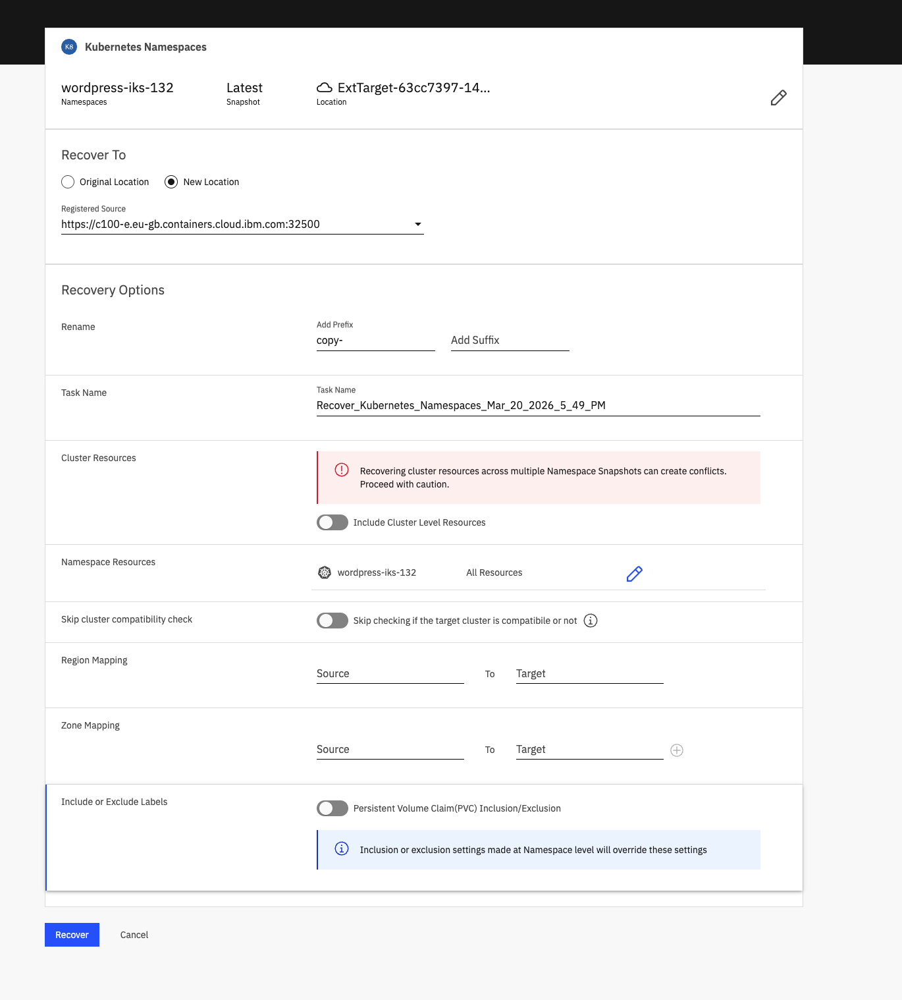
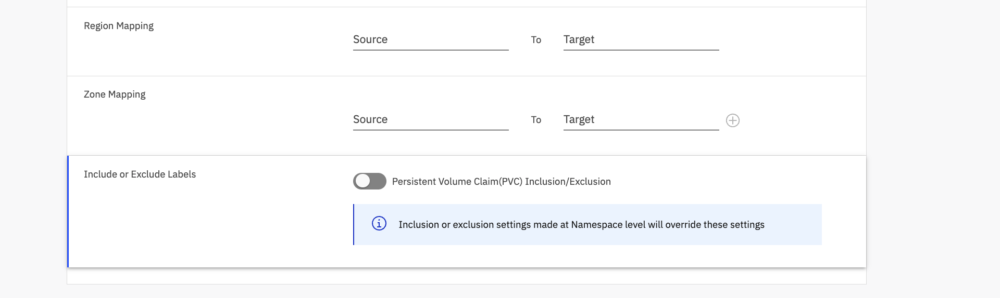

---

copyright:
  years: 2025, 2026
lastupdated: "2026-10-09"

keywords: data source connector, iks, roks, cluster, recover

subcollection: backup-recovery

---

{{site.data.keyword.attribute-definition-list}}

# Recover Kubernetes namespaces
{: #recovering-restoring-backup}

After protecting your Kubernetes namespaces, you can use {{site.data.keyword.baas_full_notm}} to recover them to:
- The original (same) Kubernetes or OpenShift cluster
- A different Kubernetes or OpenShift cluster that is registered with {{site.data.keyword.baas_full_notm}}

## Recover namespaces to the original or a different Kubernetes or OpenShift cluster
{: #recovering-same-location}

When you recover namespaces to their original location (the same Kubernetes or OpenShift cluster), or to a new location (different Kubernetes or OpenShift cluster) that is registered with the same {{site.data.keyword.baas_full_notm}} instance, only the resources, PVCs, or metadata that are **missing or deleted** are recovered from the selected snapshot by default. {{site.data.keyword.baas_full_notm}} does not overwrite existing resources unless the recovery is configured to do so.

For example, if a namespace that you want to recover contains a deployment resource and a service account, and the service account is missing but the deployment resource still exists, {{site.data.keyword.baas_full_notm}} recovers only the service account and skips the deployment resource.

### Restoring data into existing PersistentVolumeClaims
{: #recovering-existing-pvc-data}

{{site.data.keyword.baas_full_notm}} can be configured to write backed-up volume data into PersistentVolumeClaims (PVCs) that already exist in the target namespace. When this behavior is enabled:

- Files in the target PVC that share the same name as files in the backup are **overwritten** with the backed-up content.
- Files that are present in the backup but not in the target PVC are **created**.
- Files that exist in the target PVC but are **not present** in the backup are **not deleted**.
- For block volumes, all data blocks — including zero-filled blocks — are written to fully overwrite stale data on the existing volume.

**Stop or scale down your workloads before recovery.** If a live application is actively using a PVC in the target namespace when backed-up data is written into it, the running workload can be corrupted. Before initiating a recovery that targets an existing PVC, stop or scale down all applications that own the affected PVCs, or recover to a different namespace instead. After recovery completes, an application restart may be required for the PVC data change to become visible to the application.
{: important}

This PVC overwrite behavior applies when recovering to a namespace that already contains PVCs with matching names. If you want to avoid overwriting existing PVC data, recover to a new or renamed namespace instead.
{: tip}

## Steps to recover namespaces
{: #recovering-restoring-same-location}

1. [Access your {{site.data.keyword.baas_full_notm}} instance](/docs/backup-recovery?topic=backup-recovery-data-source-connector-iks-roks#data-source-connector-iks-roks-access-instance).
2. Go to `Dashboard` \> `Data Protection` \> `Recoveries`.
7. Click `Recover` on the upper-right side of the page, then select `Kubernetes Cluster` \> `Namespace`.

    

8. In the **New Recovery** modal:
    *   Search for the namespace or **Protection Group** you want to recover.
    *   You can enter the namespace name, Protection Group name, or use the wildcard character `*` for partial matches.
    *   Filter results by **Source**, **Protection Group**, or **date range**.

    

9. Identify the item that you want to recover. Items in the list are distinguished by their type:
    *   **Protection Groups**: Identified by a blue 'K8' icon. Represents a group of one or more namespaces.
    *   **Namespaces**: Identified by a gray hexagon icon. Represents an individual Kubernetes namespace.
    *   To recover the latest snapshot, select the checkbox next to the item name.
    *   To recover a specific snapshot:
        1. Click the **Edit** (pencil) icon next to the item name.
        2. In the recovery point selection view, select the snapshot that you want from the list.
        3. Click **Select Recovery Point**.

    When recovering an entire Protection Group (by selecting the blue K8 icon), advanced registration options are not available in the recovery workflow.
    {: note}

    

10. Click **Next: Recover Options**.

    {: caption="Recover options"}

    

11. Under **Recover To**, select one of the following options:
    *   **Original Location** - Select **Original Location** to recover the namespace to the same cluster.
    *   **New Location** - Select **New Location** to recover the namespace to a different Kubernetes or OpenShift cluster. Under
    **Registered Source**, select the destination Kubernetes or OpenShift cluster (or click **Register Source** to add a new one).

    If one or more namespaces being recovered already exist in the target location, a warning is displayed: _"This action will overwrite the existing namespaces."_ This warning might not appear if the namespace was created less than 8 hours ago because the source periodic sync runs every 8 hours. Until the next sync completes, {{site.data.keyword.baas_full_notm}} might not detect the newly created namespace.
    {: important}

    
12. Configure the **Recovery Options** as needed. For information on filtering specific resource types (such as LoadBalancer Services) from the restore, see [Excluding resources during namespace restore](/docs/backup-recovery?topic=backup-recovery-restore-resource-filter).
    *   **Rename**: Add a **Prefix** or **Suffix** to the names of recovered namespaces. By default, the prefix `copy-` is added to the original namespace name.
    *   **Task Name**: View or customize the name of this recovery task.
    *   **Skip cluster compatibility check**: Toggle to enable or disable skipping the compatibility check for the target cluster. Compatibility is determined on the basis of the availability of Custom Resource Definitions (CRDs) in the target cluster. If the target cluster does not have the required CRDs, the recovery might fail or produce incomplete results.
    *   **Include or Exclude Labels**: Filter **Persistent Volume Claim (PVC)** based on labels.
        *   **Logical Rule**: Select **Match Any of the following labels** or **Match All of the following labels**.
        *   Choose to **Include** or **Exclude** matched labels.
        *   Enter the label **key** and **value**, then click **+ Add**.
    *   **Cluster Resources**: Control which cluster-scoped Kubernetes resource types are recovered alongside namespace resources.
        *   Toggle **Include Cluster Level Resources** to recover cluster-scoped resources. Recovering cluster resources can create conflicts if matching resources already exist in the target cluster — proceed with caution.
        *   Select the **Snapshot with Cluster Resource** from the dropdown if multiple are available.
        *   For granular control over which cluster-scoped resource types to include or exclude, use the recovery API. Set `recoverClusterScopedResources` under `recoverNamespaceParams.kubernetesTargetParams` with either `includedClusterScopedResources` or `excludedClusterScopedResources` (mutually exclusive). Before specifying resource types, call `POST /data-protect/snapshots/{snapshotId}/meta-info` to retrieve the exact `backedUpResources` list for the snapshot, then pass the entries from that response without modification.

        The following constraints apply to cluster-scoped resource recovery:
        - Cannot be combined with PVC-only recovery (`recoverPvcsOnly: true`).
        - Cannot be combined with label-based VM selection.
        - A single recovery task can select cluster-scoped resources from only one namespace snapshot.
        - `Node`, `Namespace`, and `CSINode` resource types cannot be explicitly included or excluded.
        - On OpenShift clusters, resource types that share the same internal etcd object (for example, `clusterroles.rbac.authorization.k8s.io` and `clusterroles.authorization.openshift.io`) must both be excluded if you intend to exclude that type.
        {: note}
    *   **Namespace Resources**: Choose specific resources to recover. Click the **edit** icon to customize:
        *   **Resources** Tab:
            *   Toggle **Persistent Volume Claim (PVC) Inclusion/Exclusion** to filter PVCs at the namespace level.
                *   Select **Include** or **Exclude** radio button.
                *   Use the **Include PVCs** or **Exclude PVCs** dropdown to search and select specific PVCs.
                *   (Optional) Select **Recover only PVC and related resources** to limit the recovery to only the selected PVCs and their related resources.
            *   Toggle **Resource Inclusion/Exclusion** to include or exclude specific resource types.
                *   Select **Include** or **Exclude** radio buttons.
                *   Use the search bar or click **+ Add** to filter by resource type (for example, `Deployment`, `ReplicaSet`).
        *   **Storage Class** Tab:
            *   Toggle **Unbind the PVCs from their original PV mapping** if needed. This option is useful when recovering "retain" type storage classes and statically created PVCs, as it allows the PVCs to be bound to new PVs in the target cluster.
            *   Map **Old Storage Class** to **New Storage Class** by using the dropdowns.
            *   Use **Clear All** to reset mappings.

    **Alternative Region/Zone Recovery** (applicable when recovering to a different cluster): {{site.data.keyword.baas_full_notm}} supports recovering to a different region or zone.
    *   **Region Mapping**:
        *   Specify the **Source** region and the **Target** region.
    *   **Zone Mapping**:
        *   Specify the **Source** zone and the **Target** zone.
        *   Click the **+** icon (if available) to add multiple zone mappings.
    *   These mappings automatically update Storage Classes, Secrets, and PersistentVolumes during recovery.

      

      {: caption="Mapping"}

13. Click **Recover**. You can monitor the progress on the **Recoveries** page.


## Restore hooks
{: #restore-hooks}

Restore hooks let you run application-specific commands while a namespace is being recovered — before pod application containers start (pre-recovery) or after a container is available (post-recovery). They are useful for stateful applications that need preparation steps or post-restore reconciliation before they are ready to serve traffic.

Restore hooks are supported for namespace recovery when pods are included in the selected snapshot and recovery. Hooks are **not** supported when `recoverPvcsOnly` is true, when pods are excluded from the recovery, or when the snapshot contains no backed-up pods.
{: important}

### How restore hooks work
{: #how-restore-hooks-work}

- **Pre-recovery hooks** inject init containers into each matching restored pod. The init containers run setup commands before the pod's application containers start. They can mount volumes already defined in the pod.
- **Post-recovery hooks** execute commands inside containers of matching restored pods. By default, a command runs only after its target container is `Ready`.

Hooks apply only to pods whose labels match every key-value pair in the hook's `labelSelector`. A hook rule whose selector matches no restored pods is a no-op — the recovery does not fail for that reason.

If a restored pod already exists in the destination namespace, both pre- and post-recovery hooks are **skipped** for that pod. Delete or rename the existing namespace when every matching pod must execute its hooks.
{: note}

### Configure restore hooks via the API
{: #configure-restore-hooks-api}

Set `restoreHooks` on each namespace recovery object in the recovery request:

```json
{
  "name": "recover-orders",
  "snapshotEnvironment": "kKubernetes",
  "kubernetesParams": {
    "recoveryAction": "RecoverNamespaces",
    "recoverNamespaceParams": {
      "targetEnvironment": "kKubernetes",
      "kubernetesTargetParams": {
        "objects": [
          {
            "snapshotId": "<namespace-snapshot-id>",
            "restoreHooks": [
              {
                "name": "orders-database-restore",
                "labelSelector": [
                  { "key": "app.kubernetes.io/name", "value": "orders-db" }
                ],
                "preRecoveryHooks": [
                  {
                    "containerImage": "registry.example.com/restore-tools:1.0",
                    "command": "/bin/sh -c 'test -d /var/lib/orders && touch /var/lib/orders/.restored'",
                    "volumeMounts": [{ "name": "orders-data", "mountPath": "/var/lib/orders" }]
                  }
                ],
                "preRecoveryHookTimeoutSecs": 900,
                "postRecoveryHooks": [
                  {
                    "containerName": "orders-db",
                    "command": "/bin/sh -c '/opt/orders/bin/reconcile --restored'",
                    "commandTimeoutSecs": 120,
                    "waitForReady": true
                  }
                ],
                "postHookErrorPolicy": "kFail"
              }
            ]
          }
        ],
        "recoveryTargetConfig": { "recoverToNewSource": false }
      }
    }
  }
}
```
{: codeblock}

### Restore hook fields reference
{: #restore-hook-fields}

**Hook rule**

| Field | Required | Description |
|---|---|---|
| `name` | No | Descriptive rule name. Generated automatically if omitted. |
| `labelSelector` | Yes | Non-empty list of pod label key-value pairs. Every pair must match. |
| `preRecoveryHooks` | Conditional | Init containers to inject. At least one pre- or post-recovery hook is required. |
| `preRecoveryHookTimeoutSecs` | No | Maximum init time per matching pod. Default: 600 s. Range: 31–10800 s. |
| `postRecoveryHooks` | Conditional | Commands to run in matching restored pods. At least one pre- or post-recovery hook is required. |
| `postHookErrorPolicy` | Yes | `kFail` (default — stops recovery on failure) or `kContinue` (records warning and proceeds). |
{: caption="Hook rule fields" caption-side="bottom"}

**Pre-recovery hook**

| Field | Required | Description |
|---|---|---|
| `containerImage` | Yes | Image for the injected init container. The cluster must be able to pull this image. |
| `command` | Yes | Command string (shell-style parsing; use `/bin/sh -c '...'` for pipelines or multiple commands). |
| `containerName` | No | Name for the init container. Generated if omitted. |
| `volumeMounts` | No | Volumes from the restored pod to mount. Each entry needs `name` and `mountPath`. |
{: caption="Pre-recovery hook fields" caption-side="bottom"}

**Post-recovery hook**

| Field | Required | Description |
|---|---|---|
| `command` | Yes | Command string. |
| `containerName` | No | Target container. Velero uses the first container if omitted. |
| `commandTimeoutSecs` | No | Default: 60 s. Range: 1–10800 s. |
| `waitForReady` | No | Wait for container `Ready` before running. Default: `true`. |
| `waitTimeoutSecs` | No | Max readiness wait. Default: 600 s. Omit when `waitForReady` is `false`. |
{: caption="Post-recovery hook fields" caption-side="bottom"}

Pre-recovery hook failures always fail the namespace recovery. For post-recovery failures, `postHookErrorPolicy` controls behavior. Use `kFail` when all hooks in a recovery must succeed, and `kContinue` when partial hook failures are acceptable.
{: tip}

## Monitoring recoveries
{: #monitoring-recoveries}

You can track the status of your recovery tasks on the **Recoveries** page.

*   **Recovery list details**: The list displays key information for each task, including:
    *   **Recovery Task**: Name of the task
    *   **Start Time**: When the task was initiated
    *   **Status**: Current state of the recovery
    *   **Duration**: How long the task took to complete

*   **Dashboard overview**: View a summary of recovery tasks by status:
    *   **Succeeded**: The recovery task completed successfully
    *   **Warning**: The task completed with warnings
    *   **Failed**: The task failed to complete
    *   **Running**: The task is currently in progress
    *   **Canceled**: The task was manually canceled

*   **Filtering**: Use the available filters to narrow down the list of recoveries:
    *   **Recovered From**: Filter by source type (for example, **Cloud Archive**, **Local**, **Tape Archive**).
    *   **Recovery Type**: Filter by the type of data recovered (for example, **Files and Folders**, **Kubernetes**, **Microsoft SQL**, **Oracle**, **Physical Server**, **VMware**, **SAP HANA**, **Instana**, **Etcd**, **Volume**).
    *   **Status**: Filter by task status (for example, **Running**, **Succeeded**, **Warning**, **Failed**, **Canceled**, **Canceling**, **Skipped**, **Accepted**, **Finalizing Migration**, **In Sync**, **Migrating**, **Migration Finalized**).
    *   **Date Range**: Select a time period such as **Past Hour**, **Past 12 Hours**, **Past 24 Hours**, **Past 7 Days**, **Past 30 Days**, or a **Custom** range.


## Recovery UI Features
{: #recovery-ui-features}

| Feature | Description |
|--------|-------------|
| **Rename** | Allows you to rename the namespace in the destination cluster, creating a restoration with a custom name. |
| **Task Name** | Assigns a custom name to the recovery task for easier identification and tracking in the workflow. |
| **Cluster Resources** | Specifies which cluster-scoped resources to include in the migration. These are recovered at the cluster level in the destination. |
| **Namespace Resources** | Limits recovery to specific resources existing in the source namespace. You can also filter PVCs and related resources for inclusion/exclusion. |
| **Skip cluster compatibility check** | Bypasses version validation between source and destination clusters. Useful when restoring between different cluster types (for example, OpenShift to Kubernetes). |
| **Region Mapping** | Updates region parameters in custom StorageClasses during recover, creating them with new region values in the destination. |
| **Zone Mapping** | Updates zone parameters in custom StorageClasses during recover, applying new zone values in the destination. |
| **Include/Exclude Labels** | Filters PersistentVolumeClaims (PVCs) by label, allowing you to include or exclude specific PVCs from the migration. |
{: caption="Recovery UI features" caption-side="bottom"}
